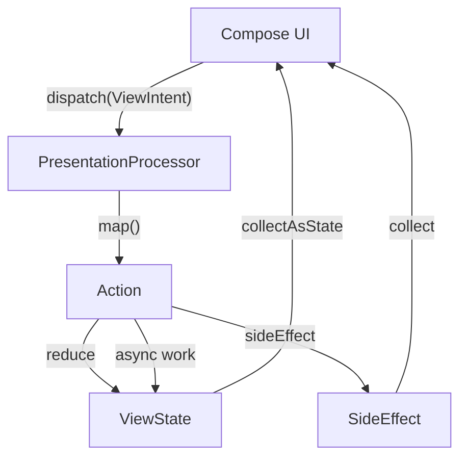
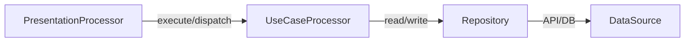

# Kide Developer Guide

Welcome to the definitive guide to **Kide**, the first AI-agent native MVI (Model-View-Intent) and Clean Architecture library built for Kotlin Multiplatform (Android, JVM desktop, iOS).

This guide explains Kide's core concepts and provides practical instructions on how to use its features during development, debugging, and testing.

---

## 1. Core Architecture Concepts

Kide enforces a strict, unidirectional data flow centered around the `PresentationProcessor`. The architecture is designed to be highly predictable, completely lossless, and safe from crashing due to unexpected errors.



### The MVI Contract
Every feature is defined by three interfaces:
1. **`ViewState`**: A completely immutable data class representing the UI's single source of truth.
2. **`ViewIntent`**: A sealed interface representing user actions or UI events.
3. **`SideEffect`**: A sealed interface representing one-off UI actions (like showing a Toast or navigating) that shouldn't be persisted.

### Execution Guarantees
- **Lossless Queues:** Intents are processed strictly sequentially in dispatch order. No intent is ever dropped.
- **Exactly-Once Side Effects:** Side effects are buffered until collected, guaranteeing they are delivered exactly once, even across configuration changes.
- **Deterministic Reductions:** Synchronous state reductions execute inline on the intent loop.
- **Resilience:** If an intent or reduction throws an exception, it is caught, logged, reported, and the processor continues with the next intent. **Your intent loop will never die.**

---

## 2. Development Instructions

### Defining the Contract
Start by creating your MVI models:

```kotlin
data class SearchViewState(
    val query: String = "",
    val results: List<Project> = emptyList(),
    val isLoading: Boolean = false,
) : ViewState

sealed interface SearchIntent : ViewIntent {
    data class UpdateQuery(val query: String) : SearchIntent
    data object TriggerSearch : SearchIntent
}

sealed interface SearchSideEffect : SideEffect {
    data class ShowToast(val message: String) : SearchSideEffect
}
```

### Implementing the Processor
Create a processor by extending `PresentationProcessor`. You only need to implement the `map()` function.

```kotlin
class SearchProcessor(
    private val useCase: SearchUseCase
) : PresentationProcessor<SearchIntent, SearchViewState, SearchSideEffect>(SearchViewState()) {

    override suspend fun map(intent: SearchIntent): Action<SearchViewState, SearchSideEffect>? =
        when (intent) {
            is SearchIntent.UpdateQuery -> reduce { copy(query = intent.query) }

            SearchIntent.TriggerSearch -> composite(
                reduce { copy(isLoading = true) },
                async(cancellationKey = "search_key") {
                    val result = useCase.execute(state.query)
                    reduce { copy(results = result, isLoading = false) }
                }
            )
        }
}
```

> [!TIP]
> **Action Builders**
> - `reduce { ... }`: Fast, synchronous state mutation.
> - `sideEffect { ... }`: Emits a side effect inline.
> - `async { ... }`: Spawns a coroutine for async work. You can assign a `cancellationKey` to cancel previous running async tasks with the same key automatically.
> - `composite(...)`: Chains multiple actions to run sequentially.

## 3. Compose Integration and Navigation

Kide's optional `kide-navigation` module integrates seamlessly with Jetpack Compose. Screens are defined via `ScreenNavKey`, linking a processor to its UI and providing persistence rules.

### Defining a ScreenNavKey
The `ScreenNavKey` defines how to instantiate the processor and how to render the screen. It also provides the state serializer for cross-process state persistence.

```kotlin
object SearchNavKey : ScreenNavKey<SearchProcessor> {
    override val serialKey: String = "search"
    
    // Instantiate processor (e.g., using DI like Koin)
    override fun createProcessor(): SearchProcessor = get()
    
    // Define the Compose UI
    override val screen: @Composable ((ScreenContext<SearchProcessor>) -> Unit)
        get() = { ctx -> SearchScreen(ctx) }

    // Persist the user's search inputs across process death
    override val stateSerializer: KSerializer<out ViewState>
        get() = SearchViewState.serializer()
}
```

### Rendering State in Compose
In your Compose screen, use `ScreenContext` to observe state and side effects:

```kotlin
@Composable
fun SearchScreen(ctx: ScreenContext<SearchProcessor>) {
    val state by ctx.processor.states.collectAsStateWithLifecycle()

    CollectSideEffects(ctx.processor) { effect ->
        when (effect) {
            is SearchSideEffect.ShowToast -> showToast(effect.message)
        }
    }

    // Your UI drawing code here, reacting to `state`
    // Example: dispatching an intent when a button is clicked
    Button(onClick = { ctx.processor.dispatch(SearchIntent.TriggerSearch) }) {
        Text("Search")
    }
}
```

Collect side effects with `CollectSideEffects` rather than a plain `LaunchedEffect`. A
`LaunchedEffect` keeps collecting while the app is in the background, so a toast or a
navigation can be consumed while nothing is visible and is then gone. `CollectSideEffects`
collects only while the lifecycle is at least `STARTED` (configurable with
`minActiveState`); effects emitted meanwhile stay buffered in the processor and are
delivered in order, exactly once, when the screen is visible again. As with any
collection of `sideEffects`, call it from exactly one place per processor.

### Navigating Between Screens
Navigation is handled via the `ScreenContext` or directly on the `AppNavBackStack`.
```kotlin
// From within a screen
ctx.navigateTo(DetailsNavKey(projectId = "123"))

// Setting up the root navigation stack in MainActivity
val backStack = rememberAppNavBackStack(SearchNavKey)
AppNavigation(backStack)
```

---

## 4. Dependency Injection Integration (`kide-koin`)

Kide integrates effortlessly with Koin using the optional `kide-koin` module. 

Instead of passing massive dependency trees, you can use Koin's `get()` to resolve your processors within `ScreenNavKey` factories (as shown above in `SearchNavKey.createProcessor()`).

The module also provides lifecycle-aware bindings. Ensure you configure your Koin modules to declare `PresentationProcessor` definitions appropriately (often as `factory` so each screen instance gets a fresh processor).

```kotlin
val searchModule = module {
    factory { SearchUseCase(get()) }
    factory { SearchProcessor(get()) }
}
```

---

## 5. Clean Architecture Integration

For large applications, use the `kide-clean-architecture` module. The UI layers interact with Domain use cases which are themselves intent-driven (`UseCaseProcessor`).



| Component | Description |
|-----------|-------------|
| **`Feature`** | The highest-level logical module grouping related presentation, domain, and data components. |
| **`UseCaseProcessor` / `UseCaseFunction`** | Encapsulates specific business rules or flows. |
| **`Repository`** | Mediates between the domain and data layers, providing domain entities from underlying sources. |
| **`DataSource`** | Abstraction for underlying data storage mechanisms (e.g., REST APIs, local databases). |
| **`Service`** | A generic component to perform operations that don't naturally fit into an entity or repository. |
| **`Manager`** | Manages state or orchestrates other lower-level components. |

### Heavyweight vs Lightweight Use Cases

**Heavyweight Use Cases (`UseCaseProcessor`)**
These act as a middle layer capable of retaining and emitting their own domain states, functioning much like an MVI processor for the domain layer:

```kotlin
class SavedProjectsProcessor(
    private val repository: ProjectRepository
) : AbstractUseCaseProcessor<SavedProjectsState, SavedProjectsIntent>(SavedProjectsState()) {
    
    override suspend fun map(intent: SavedProjectsIntent) {
        // Handle logic, interact with repo, and reduce the state
    }
}
```

**Lightweight Use Cases (`UseCaseFunction`)**
For simpler actions, Kide provides `UseCaseFunction` — a single-abstract-method (SAM) interface designed for very lightweight implementation.

```kotlin
// Domain Definition
fun interface SearchGitHubProjectsUseCase : UseCaseFunction {
    suspend fun execute(query: String, language: String?, license: String?): Result<List<Project>>
}
```

Because it is a functional interface, Kide avoids the boilerplate of creating concrete implementation classes (like `SearchGitHubProjectsUseCaseImpl`). Instead, the interface is implemented directly via a lambda block that delegates to the repository. This is typically wired up in your Dependency Injection configuration:

```kotlin
// Dependency Injection Configuration (e.g., using Koin)
factory<SearchGitHubProjectsUseCase> {
    val repository = get<GitHubRepository>()
    SearchGitHubProjectsUseCase { query, language, license ->
        repository.searchProjects(query, language, license)
    }
}
```

**Benefits of Lightweight Use Cases:**
- **Zero Boilerplate:** Completely eliminates the need to write and maintain redundant `*UseCaseImpl` classes just to forward calls to a repository.
- **Pure and Focused:** Keeps business rules strictly defined by the interface signature.
- **Easy to Mock:** Trivial to mock or fake using lambdas in your unit tests without needing complex mocking frameworks.

---

## 6. Debugging

### Built-in Logging (`KideLog`)
Use the `KideLog` facility, which provides lazy, class-tagged logging functions:

```kotlin
class SearchProcessor : PresentationProcessor<...> {
    fun doSomething() {
        logD { "This runs lazily and tags output as 'SearchProcessor'" }
        logE(exception) { "Something broke" }
    }
}
```

### Agent-Native Debugging (`kide-devtools`)
Kide is specially designed to let AI coding agents debug your running app directly.
Instead of relying only on traditional GUI debug tools, you attach a `FlightRecorder` and `KideMcpServer`.

> [!IMPORTANT]
> Ensure the MCP Server (`KideMcpServer.start(context)`) is strictly limited to debug builds.

Your AI Agent can connect to your running app via an MCP port (`http://localhost:8765/mcp`). 
The Agent can read a queryable trace of the processor's life (intents, actions, state diffs, errors) to instantly find and fix bugs.

#### Tracing the domain layer too

A `FlightRecorder` on its own covers the presentation layer. Add a `UseCaseFlightRecorder`
(module `kide-clean-architecture-devtools`) writing to the **same** `TraceBuffer`, and the
domain layer joins the same causally ordered stream:

```kotlin
val buffer = TraceBuffer()                       // one per application is fine

val savedProjects = SavedProjectsProcessor(
    repository,
    interceptors = listOf(UseCaseFlightRecorder(buffer)),
)
val recorder = FlightRecorder<SearchIntent, SearchViewState, SearchSideEffect>(buffer)
val processor = SearchProcessor(searchUseCase, savedProjects, interceptors = listOf(recorder))

KideDebug.attach("search", processor, recorder)
```

A use case shared by several screens — the usual case for a DI singleton — needs its recorder
at construction, which is why an application-wide buffer is normally simpler than one per
screen.

#### Reading a trace

Every event carries a `correlationId` grouping everything one interaction caused, and a
`source` of either `Presentation` or `Domain`. The id travels in the coroutine context, so it
survives an `AsyncAction`, a `withContext(Dispatchers.IO)` and the call into a use case; no
code passes it by hand.

To work out why something *didn't* happen, group by `correlationId` and find where the chain
stops:

| Trace stops after | Diagnosis |
|---|---|
| `Intent` | `map()` returned `null`, or the intent matched no branch |
| `ActionExecuting`, no `Domain` events | the use case was never dispatched to |
| `Domain Intent` | the use case ran and reduced nothing |
| `Domain StateChanged` | the domain updated and the UI never reflected it |

`"correlationId": null` is legitimate rather than a gap — work with no originating intent, such
as a repository flow collected at application startup.

---

## 7. Testing

Kide processors are standard Kotlin classes, and testing them is incredibly straightforward using `kide-test`.

> [!IMPORTANT]
> When testing processors, always set the Main dispatcher to `UnconfinedTestDispatcher()`. This ensures that dispatch mechanisms are perfectly synchronous during tests.

```kotlin
// In a Kotest DescribeSpec

beforeSpec {
    Dispatchers.setMain(UnconfinedTestDispatcher())
}

it("updates query and triggers search") {
    val processor = SearchProcessor(FakeSearchUseCase())

    processor.test {
        dispatch(SearchIntent.UpdateQuery("kotlin"))
        expectState { it.query == "kotlin" }
        
        dispatch(SearchIntent.TriggerSearch)
        expectState { it.isLoading }
        // Verify subsequent states...
    }
}
```

The DSL allows you to `dispatch` intents and strictly `expectState` and `expectSideEffect` in exactly the order they occur.

---

## 8. Kide Demo App

The Kide library includes a complete sample application in the `app` module. It serves as a comprehensive reference demonstrating how all the pieces of the Kide ecosystem fit together.

**Key features of the Demo App:**
- **Modularization:** Divided into distinct feature modules (e.g., `feature.search`), demonstrating scalable project structures.
- **Koin Integration:** Fully leverages Koin for dependency injection across presentation, domain, and data layers.
- **Navigation:** Shows advanced usage of `ScreenNavKey`, back-stack management, and cross-process persistence.
- **Clean Architecture:** Implements Repositories, DataSources (using Room and DataStore), and UseCases properly decoupled from the UI.
- **Agent Debugging:** Includes the `kide-devtools` integration out-of-the-box in debug builds, allowing you to connect an AI agent to the emulator and test the MCP features firsthand.
- **Jetpack AppState (experimental):** The Search screen's offline notice is fed by `kide-appstate`; see section 9.

---

## 9. Jetpack AppState (experimental, `kide-appstate`)

> [!WARNING]
> [Jetpack AppState](https://developer.android.com/topic/libraries/architecture/appstate) is in
> alpha, and so is this module. `kide-appstate` has its own pre-release version, its own
> [changelog](../kide-appstate/CHANGELOG.md) and `kide-appstate-<version>` tags, targets Android
> and JVM only, and is not covered by Kide's compatibility guarantees. Every declaration
> requires `@OptIn(ExperimentalKideAppStateApi::class)`. No other Kide module depends on it.

AppState takes Compose `State` out of the UI: a `@Composable` block runs in a headless
composition and recomposes whenever a `State` it read changes. `kide-appstate` lets a
`PresentationProcessor` use such a block as an **input** to its `ViewState`.

### Where each kind of state lives

| State | Example | Where it lives in a Kide app |
|---|---|---|
| Screen state | query, selection, loading, results | `ViewState`, changed only by `reduce` |
| Live state, shared | connectivity, a running session | a `Manager` or `Service` exposing Compose `State<T>` |
| Session state, shared across components | a timer shared with a widget or service | AppState `StateStore` |
| Durable data | settings, saved items | a repository `Flow` |

Screen state stays in `ViewState`, and its persistence stays with
`ScreenNavKey.stateSerializer`. The other three are *inputs*: `kide-appstate` brings them in.

### Feeding a processor

`transformFlow { }` turns a headless composition into a cold `Flow`. The processor's existing
`observe` collects it, which is what gives it a lifetime (cancelled by `close()`), keyed
replacement, error routing to `onObservationError`, and reductions that are reported to
interceptors and visible to the agent port:

```kotlin
@OptIn(ExperimentalKideAppStateApi::class)
class SearchProcessor(
    private val savedProjects: SavedProjectsProcessor,
    private val connectivity: ConnectivityService,   // val isOnline: State<Boolean>
) : PresentationProcessor<SearchIntent, SearchViewState, SearchSideEffect>(SearchViewState()) {

    init {
        observe("connectivity", transformFlow {
            if (connectivity.isOnline.value) {
                null
            } else {
                val saved by savedProjects.stateFlow.collectAsState()
                saved.projects.size
            }
        }) { savedCountWhileOffline ->
            reduce { copy(offlineSavedCount = savedCountWhileOffline) }
        }
    }
}
```

Inside the block, Compose `State` is read with `.value` and a `Flow` with `collectAsState`.
Dependencies are tracked by what the block actually reads: above, the saved projects are not
tracked at all while the device is online. For a single `State`, `state.asFlow()` is enough:
`observe("online", connectivity.isOnline.asFlow()) { reduce { copy(online = it) } }`.

### Rules

- **The result is conflated.** If several inputs change before the block recomposes, only the
  latest result is reduced. Use it for the *current value* of something. Values that must each
  be seen stay a plain `Flow` in `observe`; things that happen stay intents.
- **The first value arrives after the first composition**, so one frame can render without it.
  Give the `ViewState` field an honest default.
- **The block cannot see the processor's own `state` change.** `state` is not Compose `State`;
  read `states.collectAsState()` inside the block if a result depends on the view state.
- **It keeps running in the background**, like any `observe`. There is no lifecycle in a
  headless composition, so `collectAsStateWithLifecycle` is not available inside the block.
- **Nothing else changes.** Screens still render `processor.states`; intents, reducers and side
  effects work exactly as before.

### Sharing domain state through a StateStore (`kide-clean-architecture-appstate`)

`transformFlow` brings Compose `State` *into* a presentation processor. The second
experimental module goes the other way for the domain layer: it publishes a
`UseCaseProcessor`'s state into an AppState `StateStore`, where another activity, a service,
a widget or a `transformFlow` block can read it as Compose `State`. It is released with
`kide-appstate`, under the same version.

```kotlin
// Once, at application start — before anything else asks the store for the key.
savedProjects.mirrorTo(stateStore, SavedProjectsKey, applicationScope)

// Anywhere in the process:
val saved: State<SavedProjectsState> = stateStore.getState(SavedProjectsKey)
```

The mirror is one-way. The processor remains the only place the state changes, so every
change still goes through its intents and its interceptors; the store is a read replica.
Keep the key `internal` to the module that owns the processor.

For a key persisted with AppState's DataStore integration, pass a restore function too. A
value the mirror did not write — the one loaded from disk at start-up — is turned into an
intent and dispatched, so a restored state is an ordinary, traced change:

```kotlin
savedProjects.mirrorTo(stateStore, SavedProjectsKey, applicationScope) { persisted ->
    RestoreSavedProjects(persisted)      // or null to ignore it
}
```

Things to know, all found by testing against AppState `1.0.0-alpha02` rather than read from
its documentation:

- **Call `mirrorTo` at application start.** A StateStore key is not safe to create from two
  threads at once: a reader that asks for it while it is first being written can be handed a
  `State` that never updates. `mirrorTo` creates the key before it returns.
- **Never write the key yourself, and do not use `StateStore.updateState` concurrently.**
  It is not atomic; concurrent updates are lost.
- **The persisted value loads a few milliseconds after start and replaces what the key
  held.** A domain change made before that can be replaced by the restored state.
- **Give the key the processor's initial state as its default.**
- **Persistence is Android-only**, because `statestore-datastore` is. On JVM desktop the
  mirror works in memory.

### Testing

A processor whose `transformFlow` inputs keep their defaults reduces nothing, so existing
tests are unaffected — pass a fake whose `State` holds the default. To drive the composition
deterministically, use AppState's `transformTest` and run both the processor and the
composition on its dispatcher:

```kotlin
// testImplementation("androidx.appstate.transform:transform-testing:<version>")
it("shows what is available offline") {
    transformTest {
        val isOnline = mutableStateOf(true)
        val processor = SearchProcessor(
            savedProjects = savedProjects,
            connectivity = FakeConnectivity(isOnline),
            dispatcher = testDispatcher,                                   // for transformFlow
            processorScope = CoroutineScope(SupervisorJob() + testDispatcher),
        )

        isOnline.value = false
        advance()
        advance()

        processor.state.offlineSavedCount shouldBe 2
        processor.close()
    }
}
```

That requires the processor to take the composition's dispatcher as a constructor parameter
and pass it to `transformFlow(dispatcher) { }`. `advance()` runs pending coroutines and applies
snapshot changes; call it after each write, twice when a reduction has to follow a
recomposition.

In the demo app, the Search screen's offline notice is built this way: `NetworkMonitor`
(framework) → `ConnectivityService` (adapter) → `SearchProcessor`.
